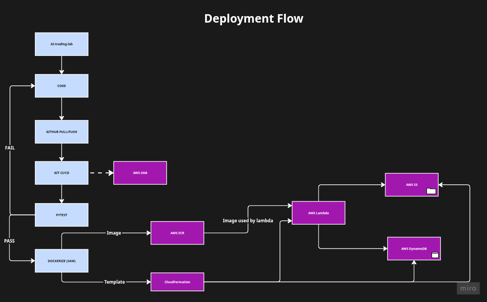

# AI Trading Lab

## Description
An automated paper-trading system that tests whether a local LLM improves a rules-based strategy. Portfolio A trades on statistics alone, Portfolio B uses the same rules but lets an LLM block or shrink trades after reading the news, and both are compared to the S&P 500.

## Deployment Diagram

## Tech Stack
- Python, pytest
- AWS: Lambda, ECR, DynamoDB, S3, EventBridge Scheduler, IAM (OIDC)
- AWS SAM + CloudFormation, Docker, GitHub Actions
